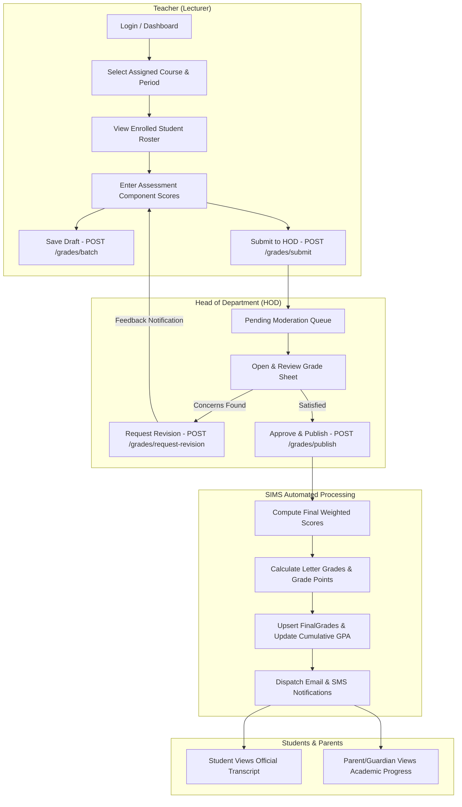
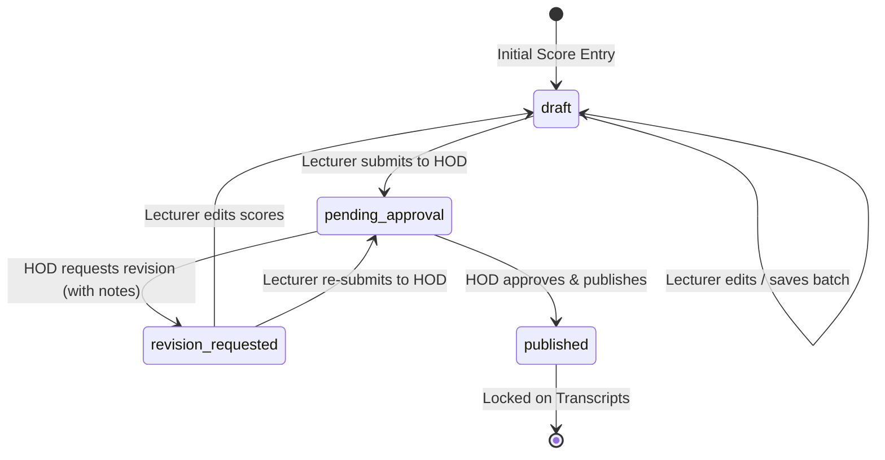

# SIMS End-to-End Teacher & HOD Grading Workflow

## 1. System Overview & Architecture

The Student Information Management System (SIMS) enforces an institutional **two-step academic grading and moderation lifecycle**:
- **Lecturers (Teachers)** have write access to student assessment component scores for their assigned courses.
- **Heads of Department (HODs)** have oversight and moderation authority over courses in their department.
- **Grades remain confidential** in `draft`, `pending_approval`, or `revision_requested` states until the Head of Department explicitly approves and publishes them.
- **On publication**, student `final_grades` are upserted, cumulative GPAs are calculated, official transcripts are updated, and multi-channel notifications (Email + SMS) are dispatched to both students and registered parents/guardians.

---

## 2. Four-State Submission Lifecycle

The `grades` table transitions through four distinct lifecycle states governed by strict role-based access controls (RBAC):

### State Definitions & Permissions

| Lifecycle State | DB Value (`GradeStatus`) | Who Can Edit? | Visibility Scope | Action Trigger |
| :--- | :--- | :--- | :--- | :--- |
| **Draft** | `draft` | Assigned Lecturer, Admin | Lecturer only | Saved via `POST /grades/batch` or `PUT /grades/...` |
| **Pending Approval** | `pending_approval` | Locked (no one) | Lecturer, HOD, Admin | Submitted via `POST /grades/submit` |
| **Revision Requested** | `revision_requested` | Assigned Lecturer, Admin | Lecturer, HOD, Admin | Returned via `POST /grades/request-revision` |
| **Published** | `published` | Locked (Admin override only) | All (Student, Parent, HOD, Lecturer) | Approved via `POST /grades/publish` |

---

## 3. Step-by-Step Walkthrough

### Phase 1: Teacher (Lecturer) Mark Entry & Submission

1. **Authentication & Course Discovery**:
   - The Lecturer logs in through `/login`.
   - On the `LecturerDashboard` (`/dashboard`), the system displays the **"My Courses & Grade Entry Workflow"** card populated by `GET /grades/my-courses`.
   - The Lecturer clicks **"Enter Marks"** next to a course, opening the `GradesPage` workspace (`/grades?courseId={id}&periodId={periodId}`).

2. **Roster & Assessment Components Loading**:
   - The frontend requests `GET /grades/sheet/:courseId/:periodId`.
   - The backend validates that the caller is assigned to this course via `CourseLecturer` (or has admin privileges).
   - If no assessment components exist, the backend automatically provisions default components:
     - **Continuous Assessment** (Weight: 40%, Mandatory: true)
     - **Final Examination** (Weight: 60%, Mandatory: true)
   - The backend joins the `enrollments` table with `student_profiles` to generate the complete class roster.

3. **Inline Score Entry & Live Client Calculation**:
   - The roster table renders an input cell (`InputNumber`, `0-100`) for each assessment component.
   - When the teacher modifies a score, the table instantly computes in real time:
     $$\text{Total Score} = \sum_{i=1}^{n} \left(\frac{\text{Score}_i \times \text{Weight}_i}{100}\right)$$
   - The projected **Letter Grade** and **Grade Points** update dynamically based on the institutional grading scale:
     - $90 - 100\% \rightarrow \mathbf{A+} \text{ (4.00)}$
     - $85 - 89\% \rightarrow \mathbf{A} \text{ (4.00)}$
     - $80 - 84\% \rightarrow \mathbf{A-} \text{ (3.75)}$
     - $75 - 79\% \rightarrow \mathbf{B+} \text{ (3.50)}$
     - $70 - 74\% \rightarrow \mathbf{B} \text{ (3.00)}$
     - $65 - 69\% \rightarrow \mathbf{B-} \text{ (2.75)}$
     - $60 - 64\% \rightarrow \mathbf{C+} \text{ (2.50)}$
     - $50 - 59\% \rightarrow \mathbf{C} \text{ (2.00)}$
     - $40 - 49\% \rightarrow \mathbf{D} \text{ (1.00)}$
     - $< 40\% \rightarrow \mathbf{F} \text{ (0.00)}$

4. **Saving Drafts**:
   - The teacher clicks **"Save Draft"** (`POST /grades/batch`).
   - The backend upserts the rows with `status = 'draft'` and `is_published = false`.
   - A single audit log entry is recorded (`recordType: 'grades_batch'`).

5. **Submitting to HOD**:
   - The teacher clicks **"Submit to HOD"** (`POST /grades/submit`).
   - The system checks that the academic period is not locked (`423 LOCKED` check).
   - The system validates that enrolled students have entered scores.
   - All `Grade` records for `(courseId, periodId)` are atomically updated to `status = 'pending_approval'`.
   - Editing is locked in the UI.
   - An asynchronous notification job (`grade_approval_requested`) is pushed to the BullMQ email queue addressed to the Department Head.

---

### Phase 2: Head of Department (HOD) Moderation

1. **Notification & Queue Discovery**:
   - The HOD logs in.
   - `DeptHeadDashboard` displays an alert: **"X Course Grade Sheet(s) Submitted for Moderation"** and a badge on the **"Grade Moderation & Approvals"** tab.
   - The HOD clicks **"Review & Moderate"**, loading `/grades?courseId={id}&periodId={periodId}`.
   - Alternatively, on `GradesPage`, the HOD switches to the **"Pending Moderation Queue"** tab (`GET /grades/pending-approval`).

2. **Roster & Assessment Inspection**:
   - The HOD opens the grading sheet (`GET /grades/sheet/:courseId/:periodId`).
   - The UI displays the amber banner: **"Pending HOD Approval — Grades Under Review"**.
   - The HOD evaluates student performance, component distributions, and overall grade projections.

3. **Path A — Requesting Revision (Feedback Loop)**:
   - If the HOD notices errors, grading curve issues, or missing scores:
     - Clicks **"Request Revision"**.
     - Enters feedback in the modal prompt (e.g. *"Please verify the Continuous Assessment weighting and re-check student STU-102 exam paper"*).
     - The frontend submits `POST /grades/request-revision` with `{ courseId, periodId, reason }`.
     - The backend updates all grade rows to `status = 'revision_requested'` and stores `moderation_note = reason`.
     - An email notification (`grade_revision_requested`) is enqueued to the assigned lecturer.
     - When the teacher opens `/grades`, a red banner appears displaying the HOD's feedback note. The input cells unlock so the teacher can make corrections and re-submit.

4. **Path B — Approving & Publishing**:
   - If the HOD approves the marks:
     - Clicks **"Approve & Publish"**.
     - The frontend submits `POST /grades/publish` with `{ courseId, periodId, force: false }`.
     - **Missing Score Check**: If any student is missing a mandatory assessment component score and `force !== true`, the backend returns `{ warning: true, affectedStudents: [...] }`. The UI presents a confirmation modal asking whether to cancel or force-publish.
     - **Finalization**:
       1. All `Grade` rows are updated: `is_published = true`, `status = 'published'`, `published_at = new Date()`, `moderation_note = null`.
       2. Final weighted scores and grade points are computed via `GpaCalculatorService`.
       3. Records are upserted into the `final_grades` table.
       4. Notifications are pushed to BullMQ queues:
          - **Student Email**: `grade_published`
          - **Student SMS**: `grade_published`
          - **Parent/Guardian Email**: `grade_published` (for all guardians linked via `guardian_student_links`).
       5. Audit log is written (`recordType: 'grades'`, `published_student_count`).

---

### Phase 3: Student & Parent/Guardian Experience

1. **Student Transcript View**:
   - The Student visits `/grades`.
   - The page renders their official academic transcript (`GET /grades/transcript/:studentId`) and cumulative GPA (`GET /grades/gpa/:studentId`).
   - Shows summary statistics cards: Cumulative GPA (e.g. `3.82 / 4.00`), Completed Courses, Total Credit Hours.
   - Shows a table of all published courses with Course Code, Title, Credit Hours, Academic Period, Final Score %, Letter Grade badge, and GPA points.

2. **Parent/Guardian Portal**:
   - The Parent/Guardian logs in and visits `/grades`.
   - The system calls `GET /guardians/me/students`.
   - Displays academic cards for each linked child showing their current enrolled programme, term-by-term approved final grades, scores, and letter grades.

---

## 4. Database Schema & Entity Relationships

```mermaid
erDiagram
    DEPARTMENTS ||--o{ COURSES : "offers"
    DEPARTMENTS ||--o| USERS : "headed by (head_id)"
    COURSES ||--o{ ASSESSMENT_COMPONENTS : "has components"
    COURSES ||--o{ COURSE_LECTURERS : "assigned to"
    USERS ||--o{ COURSE_LECTURERS : "lectures (lecturer_id)"
    ACADEMIC_PERIODS ||--o{ COURSE_LECTURERS : "period"
    STUDENT_PROFILES ||--o{ ENROLLMENTS : "enrolled in"
    COURSES ||--o{ ENROLLMENTS : "course"
    ACADEMIC_PERIODS ||--o{ ENROLLMENTS : "period"
    STUDENT_PROFILES ||--o{ GRADES : "earns"
    ASSESSMENT_COMPONENTS ||--o{ GRADES : "component"
    COURSES ||--o{ GRADES : "course"
    ACADEMIC_PERIODS ||--o{ GRADES : "period"
    STUDENT_PROFILES ||--o{ FINAL_GRADES : "transcripts"
    COURSES ||--o{ FINAL_GRADES : "course"
    ACADEMIC_PERIODS ||--o{ FINAL_GRADES : "period"
    PARENT_GUARDIANS ||--o{ GUARDIAN_STUDENT_LINKS : "links"
    STUDENT_PROFILES ||--o{ GUARDIAN_STUDENT_LINKS : "linked student"
```

### Core Table Attributes

#### `grades`
- `id` (UUID, Primary Key)
- `student_id` (UUID $\rightarrow$ `student_profiles.id`)
- `course_id` (UUID $\rightarrow$ `courses.id`)
- `academic_period_id` (UUID $\rightarrow$ `academic_periods.id`)
- `component_id` (UUID $\rightarrow$ `assessment_components.id`)
- `score` (Decimal 5,2, nullable)
- `status` (Varchar: `draft`, `pending_approval`, `revision_requested`, `published`)
- `moderation_note` (Text, nullable)
- `is_published` (Boolean, default `false`)
- `published_at` (Timestamptz, nullable)
- Unique constraint: `[student_id, course_id, component_id, academic_period_id]`

#### `final_grades`
- `id` (UUID, Primary Key)
- `student_id` (UUID $\rightarrow$ `student_profiles.id`)
- `course_id` (UUID $\rightarrow$ `courses.id`)
- `academic_period_id` (UUID $\rightarrow$ `academic_periods.id`)
- `final_score` (Decimal 5,2)
- `letter_grade` (Varchar 5, e.g. `A`, `B+`, `F`)
- `grade_points` (Decimal 3,2, e.g. `4.00`, `3.50`)
- `is_published` (Boolean, default `false`)
- Unique constraint: `[student_id, course_id, academic_period_id]`

---

## 5. API Reference

| Endpoint | Method | Permission | Description | Request Body |
| :--- | :--- | :--- | :--- | :--- |
| `/grades/sheet/:courseId/:periodId` | `GET` | `grades.read` | Complete course grading roster + components + scores | None |
| `/grades/my-courses` | `GET` | `grades.read` | List courses assigned to caller with grading status | Query: `?periodId=...` |
| `/grades/pending-approval` | `GET` | `grades.publish` | List course submissions awaiting HOD review | None |
| `/grades/batch` | `POST` | `grades.enter` | Save draft marks for multiple students/components | `{ courseId, periodId, grades: [{ studentId, componentId, score }] }` |
| `/grades/submit` | `POST` | `grades.enter` | Submit course grades to HOD for approval | `{ courseId, periodId }` |
| `/grades/request-revision` | `POST` | `grades.publish` | HOD returns sheet with moderation feedback | `{ courseId, periodId, reason }` |
| `/grades/publish` | `POST` | `grades.publish` | HOD approves, finalizes grades, and notifies students | `{ courseId, periodId, force?: boolean }` |
| `/grades/:studentId/:courseId/:comp` | `PUT` | `grades.enter` | Enter or edit a single component score | `{ periodId, score }` |
| `/grades/transcript/:studentId` | `GET` | `grades_own.read` | Official published transcript for a student | None |
| `/grades/gpa/:studentId` | `GET` | `grades_own.read` | Cumulative GPA and total credit hours | None |

---

## 6. Security, Locking & Invariants

1. **Period Lock (`423 LOCKED`)**:
   - If `academic_periods.is_locked = true`, any attempt to enter grades (`POST /grades/batch`, `PUT /grades/...`), submit for approval, request revision, or publish throws an `HttpException` with status `423` and error code `PERIOD_LOCKED`.
2. **Scoping & Authorization**:
   - Lecturers can only access courses assigned to them in `course_lecturers`.
   - Department Heads can only review, moderate, and publish courses belonging to their department (`courses.department_id = departments.id` where `departments.head_id = user.id`).
   - Admin Staff and Super Admin bypass department and lecturer assignment checks.
3. **Empty Submission Guard**:
   - `POST /grades/submit` rejects empty submissions with `400 BAD REQUEST` if no marks have been entered for enrolled students.
4. **Audit Trail**:
   - Every operation (`grades_batch`, `grades_submission`, `grades_moderation`, `grades_publish`) creates an immutable row in `audit_logs` capturing actor ID, timestamp, before/after values, and client IP.
